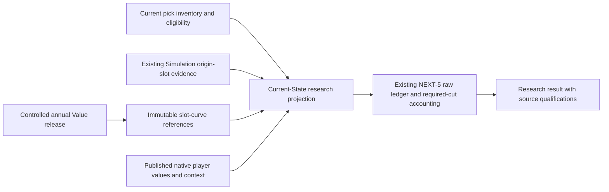

# Native pick integration design and shadow prototype

Status: proposed integration design with executable research contracts. No live
producer, route, trade classification, player value or deployment is changed.

## Recommended approach

Keep annual slot economics frozen and attach them cheaply to current picks.
Compare them under an explicit native reference policy alongside current player
publications. Reuse the accepted reference-preserving Career pattern instead of
requiring a new player valuation engine or repricing the whole cohort.

An important clarification to the preceding population study: the current Career
path computes dynamic players in an expanded game, then
`append_dynamic_career_estimates` deliberately retains its input reference rows
and appends only dynamic rows. This is the accepted
`career-frozen-reference-append-v1` policy, present in merged
[PR454](https://github.com/jderhagopian-stack/fsffl-next/pull/454), merge
`b95e6243c3858019ab837b4eac7bf44e17acf617`, and subsequent main releases. The result
is a versioned reference comparison, not a claim every published row is the
allocation of one newly recomputed game. Reference preservation during append
also does **not** declare player values season-long constants: their existing
Forecast/Value lifecycle remains authoritative.

The earlier 8.7%/9.2% mixed-population counterfactual therefore warns against calling
a mixed reference an exact joint allocation; it does not prove the existing
reference policy is invalid or require altering it. Extending that policy to
pick priors still needs empirical review. Dynamic-player acceptance is not itself
approval of an untrained future-pick model.

## One lifecycle, distinct evidence roles

The annual curve is a reusable parameter/evidence release. The attachment is a
current-State calculation: owner, origin, slot probabilities, source publication
and availability can change while slot economics stay fixed. Value owns the
curve; existing State/Simulation owners supply rights and slot evidence; Decision
owns transaction accounting. Search consumes admitted results. No new queue,
worker, cache manager, database pool or publication owner is introduced.

Platform availability attaches an existing shared release where applicable. It
does not train a model independently for each league. Scope shared work by its
actual economic, rules, selection-policy and evidence-rights dependencies; private
eligibility/history stays private. Do not key shared annual work by owner or user.

## What is implemented in research

| Component | Behavior |
|---|---|
| Existing frozen distribution curve | Preserved; consumes supplied prospective joint scenarios and existing slot-mixture authority. |
| New frozen Career reference curve | Consumes supplied complete prospective Career authorities, retaining the existing `CareerForwardModelAuthority` reference/range. |
| Existing persistence codec | Restores either research type by explicit version through the same `PersistenceStore`; old distribution keys remain unchanged. |
| Research projection | Checks current user/league/State/generation, rules, horizon, authority kind, legal selection evidence and compatibility assessment. |
| Existing NEXT-5 accounting | Reused for sent/received reference arithmetic, missing evidence and signed mandatory cuts. No new utility or recommendation score. |

`native_pick_reference_research.py` does not forecast a prospect, fit a Career
model, supply a missing tail or convert historical outcomes into a point-in-time
forecast. Slot authorities must already represent the complete prospective
Career aggregation under the accepted owner. Weighted lower/center/upper values
remain **outer model-authority bounds**, not mixture quantiles, variance or a
confidence interval. Positive-probability missing slots withhold the result.

The codec uses version-discriminated immutable keys. Readers perform an exact
restore, never a latest lookup or model rebuild on miss. There is no new SQL or
schema. Existing invalidation/restore/source-hash checks remain in force. The
canonical publication owner selects releases and retires revoked warm references.

## Compatibility is more than an identical unit label

The research context makes these dependencies explicit:

- evaluation season and accepted horizon definition;
- current-season basis, distinguishing governed full-season components from
  remaining-production estimates without changing either authority;
- league capacity and canonical scoring signature;
- economic/data-rights scope and selection eligibility policy;
- expected-mean versus model-reference point authority;
- source model/population and publication policy;
- current publication and, where genuinely applicable, joint game fingerprint.

Three-Year retains its existing calendar and 0.85 discount. Career retains
undiscounted Y1–Y7 plus Y8+ authority. The source's scoring limitations, ignored
residual-rule qualifications and per-player input assumptions must survive the
projection. Hashing target scoring rules does not demonstrate that an upstream
model supports them; the model owner must retain its actual support disposition.

Two research comparison modes exist:

1. **Shared game:** requires compatible semantics and matching supplied joint-game
   identity. A reference-append publication cannot claim this simply by assigning
   itself a fingerprint.
2. **Frozen prior approximation:** records the exact prior release and live model/
   population policy assessed for the comparison. Forecast values can update
   under that policy without re-fitting the curve. Changed methods, eligibility,
   horizon or releases need a corresponding assessment; no automatic fallback
   changes a failed exact-game claim into an approximation.

`ResearchCompatibilityAssessment` is an evidence record, not a new approval
service. It grants no production authority. The entire prototype hardcodes
`production_eligible=false` and `live_ledger_eligible=false`, including exact-game
cases. Metadata consistency is necessary evidence, not scientific validation.
Clients must never supply values, source identities or a compatibility mode as
an alternative to producer-owned evidence and the existing publication proof.

Career's current published point is a model reference. A probabilistic pick mean
cannot silently be relabelled that reference. The new reference curve provides a
separate input contract; both sides' point authority must match. Internally the
existing mean-only ledger carries the point reference, just as the current adapter
does. Package covariance, Career variance and outcome intervals remain unavailable.

## Snapshot, selection and missingness rules

- Owner comes from current canonical pick ownership; slot evidence follows the
  original franchise. Round, draft year, State and source cutoff must match.
- Availability/eligibility is explicit source evidence. Unknown or exercised
  rights are not zero-value picks. Mere presence in historical inventory is not
  proof a right remains available.
- On selection, State's existing ingestion/transition owner publishes the new
  snapshot: the exercised right stops participating and the selected player is
  evaluated through normal player authority. Historical snapshots and prior
  slot releases remain intact. The research adapter performs no State write.
- A pick beyond the current Three-Year window has a calendar-supported zero for
  that horizon, even without a curve or slot distribution. This never implies a
  zero Career value. Unknown availability still withholds it.
- Missing one horizon, source or positive slot mass is not filled with Market,
  discarded mass, another draft year's probabilities or zero. Unrelated
  player-only transactions retain their available channel.
- Current roster cuts reuse authoritative Decision resolutions and source-bound
  native cut values. Missing cuts withhold adjusted totals; negative cut costs
  remain signed. Raw asset arithmetic is not team utility or competitive impact.

A season rollover selects a release for the new governed evaluation season and
Three-Year calendar; it cannot silently reuse the old window. This follows the
league's season coordinate, not an unconditional January 1 clock rule. Later
class-specific/declarations/NFL-draft updates remain explicit future release
stages. **Named-prospect forecasting is not a prerequisite for the initial
historical-cohort slot prior.** It remains later roadmap work as requested.

## Required producer metadata and actual remaining gaps

The current native player reader already validates the exact publication and
preserves input/dependency fingerprints, capacity, model versions, raw horizon
basis and source limitations. The shadow design should consume that existing
proof; it does not replace authentication or infer a new proof from field equality.

The future producer adapter must add explicit point/publication policy and selection
context metadata. The current append implementation hashes its reference and
expanded input identities, but does not expose both as readable lineage fields
in the returned contract. Capture known lineage at the owning producer, for
example in its existing versioned publication manifest; do not reverse-engineer
it from the final hash or rewrite old artifacts. No new lifecycle owner is needed.

Canonical `LeagueRules` currently does not fully encode rookie-versus-veteran
selection eligibility, and `DraftPick` does not carry a consumed-selection status.
Use normalized existing draft-settings/inventory evidence through Data/State;
do not assume a label such as 'rookie rounds' proves rookies-only eligibility.
The actual league evidence includes veteran selections. Future-pick projection
support is also draft-year/round specific; unavailable later-year probabilities
stay explicit. Only the existing upstream owner may validate reuse of a prior
Simulation under a fresh State binding.

Most importantly, **no validated native slot model is supplied by this integration
prototype**. Earlier rank and capital studies did not justify promoting a winner.
A first prior can use historical slot cohorts and accepted Career continuation
with documented assumptions and uncertainty, supplemented by format-specific
ADP/expert evidence for selection opportunities. Ordinal scores are not native
outcome labels. Record the reference selection/choice policy: the right to select
from an eligible pool is not automatically identical to mechanically taking the
consensus-ranked player. No Market conversion or new display anchors are chosen.

## Bounded verification and rollout sequence

The synthetic benchmark covers 370 players and 108 picks, both 12-team three-WR
Superflex and 1-QB, and both horizon contracts. It prepares one compact read per
horizon, then binds 100 packages with no slot mixtures or model fits during binding.
It does not exercise hosted latency, provider acquisition, model fitting,
production persistence, competition Simulation or real-league recommendation quality.

The first benchmark exposed repeated State serialization in the prototype.
Preparation now computes the State fingerprint once; package binding uses the
existing weak snapshot identity fence. Curves are retained by their existing owner;
the research read retains compact means and references, not scenario graphs.
Final local measurements: preparation 0.035–0.046 seconds per horizon; 100 package
bindings 0.016–0.025 seconds; metadata about 89.5 KB per prepared read and
7.1–7.3 KB per selected packet. Whole-process peak RSS was 155,288 KiB
(151.6 MiB), including imports and synthetic fixtures, not incremental Render
memory. These figures do not establish hosted performance.

Focused validation: 177 tests passed in 4.27 seconds across the new contracts,
existing research/pick bridges, Career append contracts and trade economics.
This is not a full-suite or real-league model-quality acceptance claim.

The smallest implementation sequence after model/economic review is:

1. Normalize the missing inventory/eligibility and source-context metadata within
   the existing owners, preserving numerical player outputs and historical IDs.
2. Produce and validate a shared annual historical-cohort prior on supported
   coordinates. Use the separate Career reference contract where appropriate;
   unsupported formats/horizons remain explicit. Generic contracts do not prove
   every format's actual Career model is calibrated.
3. Replay saved legal player/pick packages against matching published player
   inputs in an isolated shadow run. Check native support, ownership/conversion,
   cuts, both-team priorities/timelines and useful keep/reject cases. Research
   numbers alone cannot qualify trades as mutually beneficial.
4. Publish accepted curve references through the existing intelligence manifest;
   prove warm reuse, cold restore, partial failure and historical preservation.
5. Connect Trade Center evidence first, then discovery using existing Decision
   objectives and resource limits. Validate real candidate usefulness before
   refining ranking. Owner willingness and Market feasibility remain separate.

The prototype is not connected to those production readers. No deployment, player
repricing, plan/provider change or broad rewrite is required by this design review.
